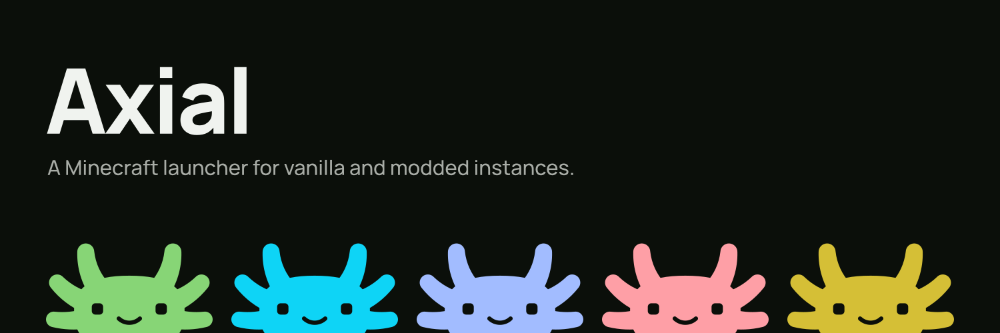

<p align="center"></p>

Axial is a Minecraft launcher for vanilla and modded instances. It installs games and loaders (Fabric, Quilt, Forge, NeoForge), manages mods, resource packs, worlds and screenshots, installs modpacks, and launches the game with Microsoft or offline accounts.

This is a pre-release. It uses its own profile and does not import data from earlier Axial versions.

## Development

Requirements: the Rust toolchain from `rust-toolchain.toml`, Node and pnpm (versions in `toolchain.json`), and [Task](https://taskfile.dev).

```sh
pnpm --dir frontend install
task dev:desktop   # desktop app with the development interface
task dev:api       # local API only, with an independent development profile
task check         # lint, contracts, frontend tests and a workspace check
task test          # Rust test suite
```

See [docs/ARCHITECTURE.md](docs/ARCHITECTURE.md) for the layout and [docs/CONVENTIONS.md](docs/CONVENTIONS.md) before contributing.
